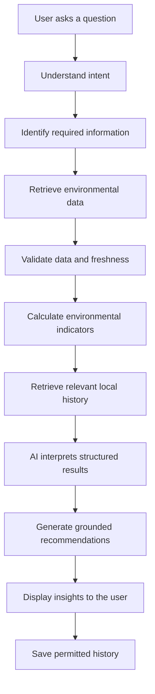
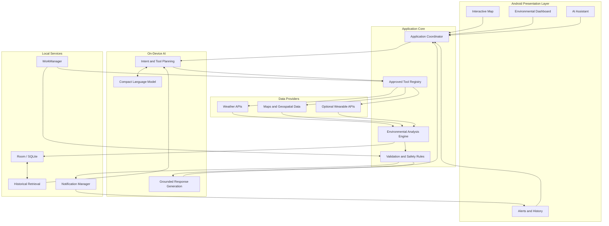
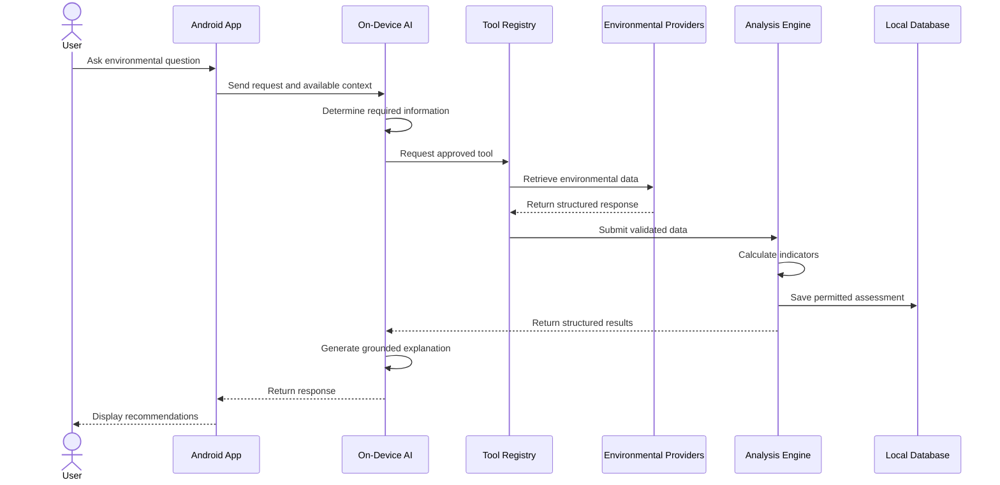
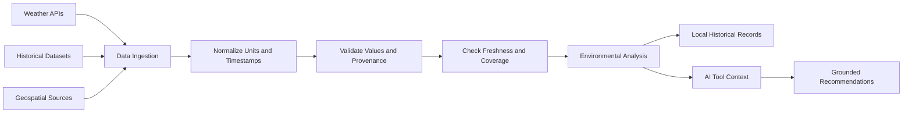
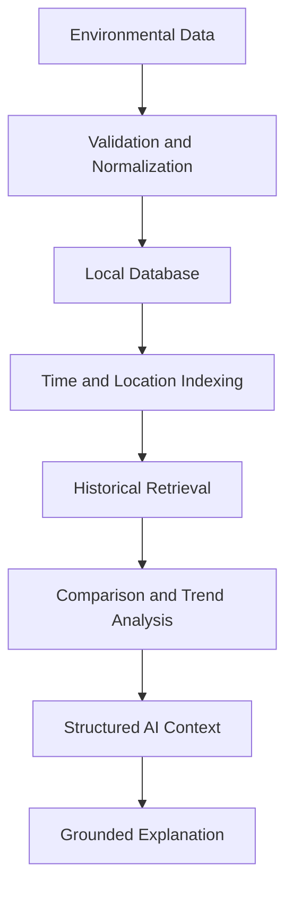

# Hydro
### Your Personal AI-Powered Environmental Intelligence Companion

**Understand your environment. Prepare for what comes next.**

Hydro is an AI-powered Android application that transforms environmental data into practical, personalized insights. It combines weather forecasts, historical environmental data, geographical context, and on-device AI to help users make informed decisions about outdoor activities and changing environmental conditions.

Instead of simply showing temperature and humidity, Hydro helps users understand what those conditions mean for their plans.

Whether you're planning a long walk, preparing for extreme heat, exploring an unfamiliar location, or comparing today's conditions with yesterday's, Hydro acts as your personal environmental scout.

---

## 🌍 The Problem

Environmental data is everywhere, but understanding what it means for our daily lives is still a challenge.

A weather application might tell you the temperature is 34°C. However, that number alone doesn't tell you everything you need to know before walking 12 km in the afternoon.

- Is it a suitable time to leave?
- How might humidity and solar exposure affect the journey?
- What should you prepare for?
- Could leaving later reduce your exposure to heat?
- How do today's conditions compare with previous days?

Weather applications provide environmental information, but users often have to interpret that information themselves.

**Hydro bridges the gap between knowing what the weather is and understanding what it means for you.**

## 💡 The Solution

Hydro combines environmental intelligence, geospatial context, local memory, and AI-powered reasoning in one Android application.

Its core capabilities include:

- **Environmental Intelligence:** Understand weather conditions, forecasts, humidity, wind, and solar exposure.
- **AI Environmental Assistant:** Ask questions about your surroundings and receive evidence-based explanations.
- **Route-Aware Planning:** Explore environmental conditions relevant to your planned journey.
- **Local Memory:** Compare historical conditions and retrieve previous environmental assessments.
- **Proactive Alerts:** Receive notifications when monitored conditions meet configured thresholds.
- **On-Device AI:** Run supported AI models locally for privacy-conscious environmental reasoning.
- **Optional Wearable Integration:** Incorporate supported activity and physiological measurements with user permission.

Hydro combines deterministic calculations with AI-driven tool orchestration. The AI interprets requests and selects approved tools, while application logic validates data, performs calculations, and enforces permissions.

## 🎯 How It Works

Consider a user asking:

> "I need to walk 12 km this afternoon. What should I prepare for?"

Hydro can retrieve available forecasts, examine relevant environmental variables, evaluate the expected conditions, and provide practical recommendations based on the available evidence.



Hydro distinguishes between observed conditions, forecast values, and calculated indicators. When information is unavailable, it communicates the limitation instead of inventing an answer.

## 🚀 Core Features

### 1. Interactive Environmental Map

Explore environmental conditions through a map-first interface.

- Display the user's location.
- Explore conditions at other locations.
- Select destinations and inspect available forecasts.
- Visualize supported environmental data.
- Explore historical conditions where data is available.

### 2. AI Environmental Assistant

Ask questions in natural language and receive explanations grounded in retrieved data.

Example questions:

- "How does today's weather compare with yesterday?"
- "What should I prepare for a long walk?"
- "When will temperatures be lower this afternoon?"
- "Why are you recommending that I reconsider this journey?"
- "What has changed in my local environmental conditions?"

### 3. Heat and Environmental Exposure Analysis

Evaluate environmental conditions using relevant variables, including:

- Air temperature.
- Relative humidity.
- Wind speed.
- Solar radiation.
- Time of day.
- Planned activity and duration.

Hydro uses documented calculations and thresholds rather than relying on the language model to invent risk scores.

Environmental assessments are informational and do not constitute medical diagnoses.

### 4. Route-Aware Planning

Help users understand environmental conditions relevant to a planned journey.

Depending on available data, Hydro can evaluate forecast conditions, identify periods of increased heat exposure, and suggest alternative departure times.

Route-specific claims require appropriate supporting data. Hydro does not assume that a route is shaded, cooler, or safer without evidence.

### 5. Personal Environmental Memory

Store permitted environmental records locally to support historical comparisons.

For example:

> "Yesterday's afternoon conditions were different from today's forecast. Here's what changed."

Hydro can retrieve previous assessments and compare compatible observations, forecasts, and measurements.

### 6. Proactive Environmental Alerts

Monitor supported data and notify users when predefined conditions warrant attention.

Potential alerts include increasing heat exposure, significant forecast changes, and conditions affecting saved journeys.

Alert generation uses explicit rules, data freshness checks, and notification deduplication.

### 7. Optional Wearable Integration

Where supported devices and APIs permit, Hydro can incorporate activity duration, step counts, heart rate, and other authorized measurements.

Wearable data provides additional context but cannot independently establish dehydration, core body temperature, or a medical diagnosis.

---

## 🏗️ Architecture

Hydro uses an Android-first, local-first architecture. Its application logic, local persistence, AI orchestration, and supported background tasks are designed to operate on the device.

External providers supply environmental data and other information when required.



### Architecture Principles

- **Local-first:** Keep application state and permitted historical records on-device by default.
- **On-device AI:** Use a compatible local model for supported inference tasks.
- **Deterministic calculations:** Handle numerical analysis, validation, permissions, and thresholds through explicit application logic.
- **Controlled tool execution:** The AI can invoke only registered tools with validated arguments.
- **Data provenance:** Preserve information about data sources, timestamps, units, and freshness.
- **Graceful degradation:** Handle unavailable providers and offline scenarios without fabricating results.
- **No mandatory custom backend:** Core functionality is designed to operate without a dedicated Hydro server, although external data providers may still be required.

**Security note:** Secret provider credentials cannot be protected simply by embedding them in an Android application. Provider access must account for credential security, quotas, and licensing requirements.

---

## 🧠 AI Agent and Tool Orchestration

Hydro's AI agent is more than a conversational interface. It interprets requests, determines which information is needed, invokes approved tools, examines structured results, and generates explanations grounded in the available evidence.

### Example Tool Registry

| Tool | Responsibility |
|---|---|
| `get_current_location` | Retrieve location when permission is granted |
| `get_weather` | Retrieve current conditions or forecasts |
| `get_historical_weather` | Retrieve historical environmental data |
| `calculate_heat_risk` | Calculate a documented environmental indicator |
| `get_route_conditions` | Retrieve supported route-related information |
| `query_memory` | Retrieve relevant local history |
| `get_wearable_data` | Access permitted measurements |
| `analyze_anomaly` | Identify changes using defined rules |
| `create_notification` | Request a notification through application policy |
| `get_heat_map` | Retrieve or derive supported spatial visualizations |

These are proposed tool interfaces; their implementation status depends on the actual codebase.

### AI Execution Flow



### Why On-Device AI?

Local inference supports Hydro's privacy-first direction and reduces dependence on remote language-model services.

Candidate models must be evaluated for:

- Tool-selection accuracy.
- Structured output reliability.
- Instruction following.
- Multi-step reasoning.
- Memory consumption.
- Inference latency.
- Battery and thermal impact.
- Model licensing and distribution requirements.

The application must validate model-generated tool arguments and enforce permissions independently of the model.

---

## 🌦️ Environmental Intelligence Pipeline

Hydro combines data from supported environmental sources and normalizes it before analysis.



### Candidate Data Sources

| Source | Potential use | Documentation |
|---|---|---|
| Open-Meteo | Weather forecasts and historical weather | [Weather API](https://open-meteo.com/en/docs) |
| Open-Meteo | Historical weather analysis | [Historical Weather API](https://open-meteo.com/en/docs/historical-weather-api) |
| NASA Earthdata | Earth observation and satellite datasets | [NASA Earthdata](https://www.earthdata.nasa.gov/) |
| NASA POWER | Solar and meteorological data | [NASA POWER](https://power.larc.nasa.gov/) |
| NiMet | Nigerian meteorological information | [NiMet](https://nimet.gov.ng/) |

These are candidate integrations, not claims that all providers are already connected. Their geographic coverage, access requirements, data quality, and licensing must be verified.

### Data Quality

Environmental records should preserve:

- Source and retrieval timestamp.
- Observation or forecast timestamp.
- Geographic coordinates or coverage.
- Units and variable definitions.
- Whether a value is observed, forecast, or derived.
- Data freshness and known limitations.

Satellite land-surface temperature must not be treated as equivalent to near-surface air temperature.

---

## 🧠 Local Memory and Historical Analysis

Hydro maintains permitted local records to support comparisons and contextual analysis.

Potential records include:

- Environmental observations and forecasts.
- Previous environmental assessments.
- Saved locations and journeys.
- Alert history.
- User-defined preferences.
- Authorized wearable summaries.



The initial implementation can use indexed local database queries rather than requiring a cloud vector database.

Historical comparisons must use compatible measurements, timestamps, and locations. Forecasts must remain distinguishable from actual observations.

---

## 🛠️ Technology Stack

| Component | Technology | Purpose |
|---|---|---|
| Android application | Kotlin | Native application logic and platform integration |
| Core engine (`:core-engine`) | Pure Kotlin / JVM + Coroutines | Domain models, Open-Meteo adapter, NOAA/NWS heat assessment, activity planning, local history, and AI tool registry |
| UI | Jetpack Compose | Android user interface |
| AI inference | LiteRT-LM (`com.google.ai.edge.litertlm:litertlm-android:0.18.0`) | On-device language-model execution (`GPU` / `NPU` / `CPU` cascading fallback) |
| AI model | `google/gemma-3n-E2B-it-litert-lm` (`gemma-3n-E2B-it-int4.litertlm`) | Multimodal intent interpretation, grounded tool orchestration, and explanation |
| Local persistence | Room / SQLite (`:app`) + `EnvironmentalHistoryStore` (`:core-engine`) | Environmental history and assessments |
| Background execution | Android WorkManager | Deferrable background monitoring |
| Mapping | Android-compatible map SDK | Maps, destinations, and supported environmental layers |
| Weather data | Open-Meteo (CC-BY 4.0 non-commercial) via `WeatherProvider` | Current conditions, hourly forecasts, and historical reanalysis |
| Wearable integration | Health Connect and supported device APIs | Permission-based access to supported measurements |
| Testing | Kotlin/JUnit unit tests + deterministic fixtures | Offline domain, mapping, planning, persistence, and tool verification |

---

## ⚙️ Core Engine Implementation & Developer Guide

Hydro's foundational environmental intelligence engine is implemented in `:core-engine` (`com.ferousco.hydro.core.*`) with Android Room persistence adapters in `:app` (`com.ferousco.hydro.data.local.*`).

Key implemented capabilities:

- **Strongly Typed Domain Models:** Explicit units (`°C`, `°F`, `K`, `%`, `m/s`, `km/h`, `mph`, `kn`, `UVI`, `W/m²`), `FieldAvailability` (`Available` vs `Unavailable` — never substituting `0.0` for missing data), and strict separation between `OBSERVED`, `FORECAST`, and `DERIVED` values.
- **Open-Meteo Weather Adapter & Cache Repository:** Typed response mapping for `/v1/forecast` (current & hourly) and `/v1/archive` (historical reanalysis), unit normalization, DST-accurate `unixtime` + IANA `ZoneId` handling, bounded retries, and cache fallback that explicitly marks cached responses (`DeliveryOrigin.LOCAL_CACHE`, `isCurrentAndLive = false`).
- **Deterministic Heat Assessment:** Official **NOAA / NWS Heat Index** (Steadman simple formula below 80°F and Rothfusz 1990 SR 90-23 regression with low/high-humidity NWS adjustments and caution tiers) plus **WHO / WMO Global Solar UV Index** categories when UV data is available.
- **Activity Window Planning:** Evaluates candidate departure slots across hourly forecasts, handles DST transitions, flags missing forecast hours or incomplete duration coverage, identifies ties within tolerance, and avoids declaring elevated-heat windows "safe".
- **Local Environmental Memory:** Stores permitted observations, past-issued forecasts, and assessments (via Room on Android or `JsonFileEnvironmentalHistoryStore` / `InMemoryEnvironmentalHistoryStore` on JVM), enforces retention and deletion policies, and validates location, diurnal time-of-day, data-type, and method compatibility before comparing records.
- **Controlled AI Tool Registry & Gemma 3n Orchestrator:** Schema-validated, capability-gated, timeout-bounded registry implementing `get_current_weather`, `get_hourly_forecast`, `get_historical_weather`, `calculate_heat_assessment`, `compare_forecast_periods`, and `query_local_history`, paired with `HydroGemmaOrchestrator` (`:core-engine`) and `LiteRtGemma3nClient` (`:app`) targeting **`google/gemma-3n-E2B-it-litert-lm`** (`gemma-3n-E2B-it-int4.litertlm`) while keeping all numerical calculations strictly outside the LLM.
- **Privacy-Safe Diagnostics:** `SanitizingDiagnosticLogger` automatically redacts precise GPS coordinates, URL query coordinates, and credential-like attributes.

For full architectural details, formulas, schemas, missing-data semantics, and limitations, see **[`docs/CORE_ENGINE.md`](docs/CORE_ENGINE.md)**.

### Running Tests

In a standard developer environment with Gradle, Android SDK, Maven Central, and Google Maven access:

```bash
gradle :core-engine:test :app:testDebugUnitTest
```

In an offline or network-restricted JVM environment with `kotlinc` and Java 17+:

```bash
./scripts/verify-core-engine.sh
```

### On-Device AI References

- [Google AI Edge](https://developers.google.com/edge)
- [LiteRT](https://developers.google.com/edge/litert)
- [LiteRT-LM](https://developers.google.com/edge/litert-lm/overview)

The selected model and runtime must be benchmarked on representative Android hardware before being finalized.

---

## 🔒 Privacy and Safety

Hydro prioritizes local processing and user control over personal information.

### Privacy

- Store permitted historical records on-device by default.
- Request permissions only when required.
- Minimize the collection of location and wearable data.
- Allow users to control retained history.
- Avoid unnecessary transmission of private local records.
- Identify external services and their data requirements.
- Never embed secret provider credentials in the application package.

### Safety and Reliability

- Validate external responses before analysis.
- Track source provenance and data freshness.
- Distinguish observations from forecasts.
- Use deterministic logic for safety-sensitive thresholds.
- Communicate uncertainty and missing data.
- Avoid unsupported medical claims.
- Apply timeouts and bounded tool execution.
- Deduplicate notifications.

### Background Monitoring

Android may delay background work because of battery optimization and system scheduling.

WorkManager periodic tasks have a minimum repeat interval of 15 minutes, and actual execution may occur later. Therefore, Hydro cannot promise exact real-time monitoring using periodic WorkManager tasks alone.

See the [Android background work documentation](https://developer.android.com/develop/background-work/background-tasks/persistent/getting-started/define-work).

---
## 📊 Evaluation

Hydro's success depends on the reliability and usefulness of its environmental intelligence.

| Area | What to measure |
|---|---|
| Data quality | Freshness, valid units, timestamps, and provenance |
| Environmental analysis | Calculation accuracy and threshold correctness |
| AI reliability | Tool-selection accuracy and grounded responses |
| Historical analysis | Correct comparisons between compatible records |
| Performance | Inference latency, memory usage, and application size |
| Efficiency | Battery consumption and thermal behaviour |
| Notifications | Useful alerts, duplicate rate, and missed threshold events |
| Privacy | Permission enforcement and local-data handling |
| Resilience | Behaviour during network failures and missing data |

Hydro should also be tested against scenarios where the correct response is to request clarification, communicate uncertainty, or explain that the available data is insufficient.

---

## 🤝 Contributing

Contributions are welcome in:

- Android development.
- Environmental data integration.
- On-device AI and tool orchestration.
- Environmental analysis.
- Local persistence and historical retrieval.
- Mapping and geospatial visualization.
- Wearable integration.
- Testing, privacy, and performance optimization.

Open an issue to discuss substantial changes before submitting a pull request.

## 📄 License

A license has not yet been specified. A `LICENSE` file should be added before distributing Hydro under an open-source license.

---

<p align="center">
  <strong>Hydro — Understand your environment. Prepare for what comes next.</strong>
</p>