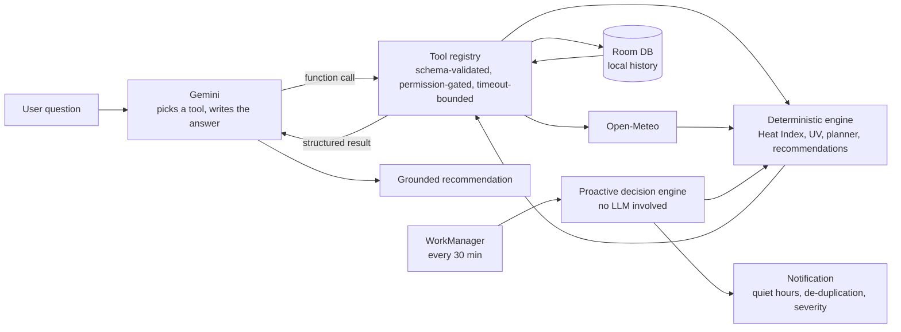
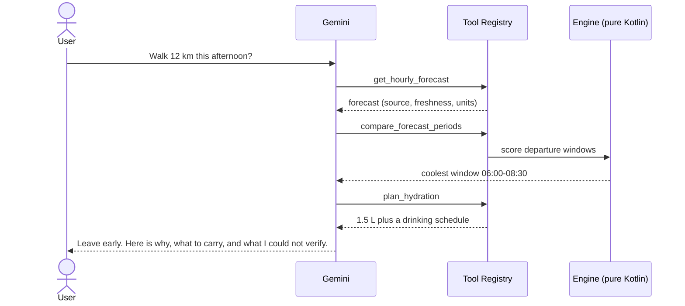

# Hydro

**Weather apps tell you it's 34°C. Hydro tells you whether to leave now or at 5 pm.**

Hydro is an Android companion that turns raw weather data into personal, evidence-backed decisions about heat, sun, air quality and hydration. It uses deterministic science for every number and AI only to explain them. It is built for Africa, starting with Nigeria.

`Kotlin` · `Jetpack Compose` · `Room` · `WorkManager` · `Gemini API` · `Open-Meteo` · `OpenStreetMap` · `Google Maps Platform`

---

## The problem

"It's 34°C." Fine, but can I walk 12 km this afternoon?

Weather apps hand you numbers and leave the interpretation to you. People then have to work out for themselves:

- Is the feels-like temperature dangerous once humidity and sun are included?
- When is the coolest window to leave?
- How much water should I carry?
- Is today actually worse than yesterday?

Getting that wrong means heat exhaustion, ruined plans and, in hot regions, real health risk. This matters most for people who work, walk or commute outdoors in hot climates, including much of Nigeria and West Africa.

## The solution

Ask Hydro a plain-language question and it:

1. Fetches live forecast and history for your location.
2. Computes heat and UV risk with published formulas (NOAA/NWS Heat Index, WHO UV Index).
3. Finds the best time window for your activity.
4. Explains what to do in plain language, and says so when the data isn't good enough.

The AI never invents a risk score. The model chooses which tool to call and phrases the answer. Every number comes from tested application code.

| Ordinary weather app | Hydro |
|---|---|
| "34°C, 70% humidity" | "Feels like 41°C. Leave before 9:00 or after 17:00, and carry 1.5 L of water." |
| The same alert for everyone | Quiet hours, severity threshold and de-duplication you control |
| Forgets yesterday | Compares today with yesterday at the same clock time |
| Silently shows stale data | Marks cached or stale data and refuses to give a false all-clear |

## Features

- **Map-first home screen.** A live map with search, activity chips, heat and air-quality layers, zoom buttons, and a draggable panel with the current temperature, heat risk, coolest window and key readings.
- **Satellite view.** One switch in the layers menu shows the ground from above, with place names on top.
- **Live location.** Tap the locate button to follow your position as you move; the weather refreshes after a real move. Tap again to stop.
- **Trip planning.** Search a place, choose walk, bike or drive, and get the route with advice on heat, water, clothing and timing. Pin places you visit often. Trips are planned inside Africa; a place on another continent gets a plain message instead of an impossible route.
- **Plain-language heat.** The risk is shown as how it feels (Freezing, Cold, Cool, Mild, Warm, Hot, Very hot, Dangerously hot) instead of agency category names.
- **Air quality and Harmattan dust.** The Now page shows the air index and the main pollutants, labelled as a modelled estimate. When dust is high it adds a clear warning, called Harmattan dust in the dry season (November to March).
- **Works with a weak signal.** The last good answer is kept on the phone, so the app opens with it and says plainly when it is showing saved data.
- **Languages.** English, Naija Pidgin and Hausa for the main screens. Screens not yet translated stay in English.
- **Trends.** The next 24 hours as live weather and as heat, with a chart you can touch to read any hour.
- **Ask Hydro.** A conversational assistant that knows your location and your current trip.
- **Alerts.** Proactive heat and UV alerts with an urgency level, quiet hours and de-duplication.
- **Wearables.** Optional, read-only heart rate and activity through Health Connect, kept on the phone unless you allow the assistant to use it.
- **Weather animation.** A sun, moon and rain that match the sky, with one switch to turn it off.

## Built for Nigeria

Hydro covers Africa, with Nigeria first. The choices below come from what is known about how people there live and what data exists.

- **Heat is a daily risk for people who cannot stay indoors.** NiMet issued repeated heat warnings in 2026, with temperatures up to about 41 to 42°C, advising people to avoid the hours from 12 to 4 pm; traders, drivers and other outdoor workers are among the most exposed ([Africanews](https://africanews.com/2026/04/08/nigeria-faces-deadly-heatwave-as-fuel-costs-skyrocket), [Guardian Nigeria](https://guardian.ng/opinion/editorial/growing-heat-crisis-demands-urgent-action/)). Hydro's advice is about when to go and what to carry, not about staying home.
- **Many phones are low-cost and data is expensive.** More than four in five smartphones sold in Nigeria in 2025 cost under 200 US dollars ([Legit](https://www.legit.ng/business-economy/technology/1727923-is-era-cheap-smartphones-nigeria-what-n100000-n300000-buys/)), and data costs are pushing some people back to feature phones ([Vanguard](https://www.vanguardngr.com/2026/06/dial-back-to-palasa-nigerians-abandon-android-smartphones-for-basic-feature-phones/amp/)). Hydro keeps the last answer on the phone and works without any Google key.
- **There is no national air-monitoring network**, and Lagos and Kano have the highest pollution, especially in the Harmattan ([Edge AI Vision](https://www.edge-ai-vision.com/?p=35097)). Hydro therefore labels its air quality as a modelled estimate rather than a measurement.
- **Maps have gaps.** OpenStreetMap, which the free map and routes use, is missing some roads in west and northwest Lagos, Ibadan and Port Harcourt ([OSM wiki](https://wiki.openstreetmap.org/wiki/Nigeria)). A Google Maps key is better there where it is available.

## How it works



Example: *"I need to walk 12 km this afternoon. What should I prepare for?"*



### Design principles

- **AI explains, code calculates.** Thresholds, formulas, safety logic and permissions live in tested Kotlin and never in the model.
- **Honest by construction.** Missing data stays unavailable and is never zero-filled. Observations, forecasts and derived values are kept distinct. Stale data is never presented as a calm all-clear.
- **Closed tool set.** The model can only call registered tools with validated arguments.
- **Privacy-first.** History stays on the device. Gemini runs stateless, so no location-bearing prompt is retained. Logs redact GPS coordinates and credentials.
- **Model-agnostic.** `LlmClient` is an interface. A benchmark harness scores tool-selection accuracy so that choosing a Gemini tier is a measurement.
- **News is treated as untrusted.** Article text is length-capped, labelled as third-party data, and the model is told never to follow instructions inside it. Only a place name, never coordinates, is sent to the news provider.

### The 24 AI tools

`get_weather` · `get_hourly_forecast` · `get_historical_weather` · `calculate_heat_risk` · `compare_forecast_periods` · `query_memory` · `get_current_location` · `analyze_anomaly` · `get_route_conditions` · `get_heat_map` · `get_wearable_data` · `create_notification` · `plan_hydration` · `get_environmental_news` · `get_air_quality` · `get_solar_climate` · `geocode_place` · `get_pollen` · `find_nearby_relief` · `get_google_weather` · `find_relief_within_reach` · `get_area_insights` · `get_elevation_profile` · `get_time_zone`

All 24 are implemented in `:core-engine`.

## Tech stack

| Layer | Tech | Why |
|---|---|---|
| App | Kotlin, Jetpack Compose | Native, with Android permissions and background work |
| Engine | Pure Kotlin/JVM module (`:core-engine`) | Platform-free, so it is fast to unit test and reusable |
| AI | Gemini API (native function calling) | Reliable tool use through a hosted model |
| Weather | Open-Meteo | Free, no API key, forecast plus historical reanalysis |
| Air quality | Open-Meteo Air Quality | Free, no key, US/EU AQI and the major pollutants |
| Satellite climate | NASA POWER | Free, no key, solar irradiance and recent climate |
| News | Tavily | Fresh local news on heat, floods and air-quality alerts |
| Maps data | Google Maps Platform | Routes, geocoding, places, weather, air quality, pollen, used whenever the key works |
| Free maps and routes | OpenStreetMap: OSRM routing, Overpass places, Esri map and satellite tiles | No key; takes over automatically when Google is missing or fails |
| Languages | English, Naija Pidgin, Hausa | A first pass that native speakers should review |
| Wearables | Android Health Connect | Read-only, per-metric consent |
| Storage | Room / SQLite | Local-first history with no custom backend |
| Background | WorkManager | Battery-friendly proactive alerts |
| Science | NOAA/NWS Heat Index, WHO UV Index | Documented, citable formulas |
| Tests | JUnit with deterministic fixtures and a fake HTTP transport | Offline and reproducible, with no API key needed |

## Run it

**Requirements:** JDK 17 or newer (Android Studio's bundled JDK works), the Android SDK, and a device or emulator on Android 8.0 or newer (`minSdk 26`).

```bash
git clone https://github.com/Ferousco-dev/hydro.git
cd hydro

# Optional: enable the AI assistant (key from https://aistudio.google.com/apikey)
echo "GEMINI_API_KEY=your-key" >> local.properties
# Optional: enable the news tool (key from https://app.tavily.com)
echo "TAVILY_API_KEY=your-key" >> local.properties
# Optional: Google Maps Platform for the map, routes, places, air quality, pollen and weather.
# Without it (or while it is not enabled) the app uses free OpenStreetMap-based providers.
echo "GOOGLE_MAPS_API_KEY=your-key" >> local.properties

./gradlew :app:assembleDebug                          # build the APK
./gradlew :core-engine:test :app:testDebugUnitTest    # run the tests
```

The app runs without any key. Weather, heat index, planning, history, alerts, the map and routes all work, and only the conversational layer reports that the model is unavailable. Search, routes, places and air quality try Google first and fall back to the free providers by themselves, so adding a working Google key switches them back with no other change. The assistant uses a second, lighter Gemini model when the first one is out of free-tier quota.

A key embedded in an APK can be extracted. Use restricted, capped keys for development. A production release should route Gemini and Google requests through a server.

## Quality

- JVM unit tests cover the heat formulas, window planning, trip advice, wearable suggestions, recommendations, memory, the tool registry, the orchestrator, the Gemini client and the benchmark harness. The Gemini client is tested against a fake transport, so no network or key is needed.
- `ToolCallBenchmarkHarness` runs a versioned prompt suite against any `LlmClient` and reports tool-selection accuracy, malformed-call rate and latency.
- The Africa outline and the Harmattan dust rules have their own tests, including real readings from Kano.
- Known gaps: Room tests use a fake DAO, and there are no instrumentation or UI tests yet.
- CI: `.github/workflows/ci.yml` runs the core and app tests and builds the debug APK.

## Limitations

- Hydro gives informational guidance, not medical advice. Wearable data can never establish dehydration or a diagnosis.
- WorkManager is best-effort. Android can delay background jobs, so alerts are not guaranteed real-time.
- Open-Meteo's free tier is non-commercial (CC-BY 4.0), so a commercial release needs a licensing review.
- Route-level claims such as shade or cooler paths are not made without supporting data.
- Hydro plans trips inside Africa only. The outline is coarse near coasts and borders, so it is not a border map.
- Air quality and dust are modelled estimates from satellite and weather models, not ground sensors.
- The free map, routing and places use public servers with fair-use limits, and OpenStreetMap has gaps in parts of Nigeria. Use a hosted plan or a Google key before heavy public use.
- Pidgin and Hausa text covers the main screens only and has not yet been reviewed by native speakers.
- On a free Gemini key the main model allows about 20 requests a day; after that answers come from the lighter model.

## What's next

- Server-side proxy for the Gemini and Google keys, so no key ships in the APK.
- NiMet data and ground air sensors, where they become available, for better Nigeria coverage.
- Native-speaker review of the Pidgin and Hausa text, and more translated screens (Yoruba and Igbo next).
- Instrumentation and UI tests.

## Repository layout

```
core-engine/   Pure-Kotlin engine: models, Open-Meteo adapter, heat and UV, planner,
               recommendations, memory, tool registry, orchestrator, Gemini client
app/           Android app: Compose UI, Room, location, WorkManager, notifications
docs/          Product, architecture, data sources, security and UX documentation
scripts/       verify-core-engine.sh
```

## Documentation

| Doc | What's inside |
|---|---|
| [PRD](docs/PRD.md) | Problem, users, requirements, metrics, risks |
| [UX and design system](docs/UX.md) | Screens, design rules, reusable components |
| [Architecture](docs/ARCHITECTURE.md) | Modules, tool registry, data flow |
| [Data sources](docs/DATA_SOURCES.md) | Every API, key, licence and caveat |
| [ADRs](docs/adr/README.md) | Why each major decision was made |
| [Setup](docs/SETUP.md) | Keys, build, troubleshooting |
| [Security and privacy](docs/SECURITY.md) | Threat model and known limits |
| [Roadmap](docs/ROADMAP.md) | Planned work |
| [Core engine](docs/CORE_ENGINE.md) | Formulas, schemas, missing-data semantics |
| [Changelog](CHANGELOG.md) | What changed and when |


## Contributing

Issues and pull requests are welcome. Please open an issue first for larger changes.
