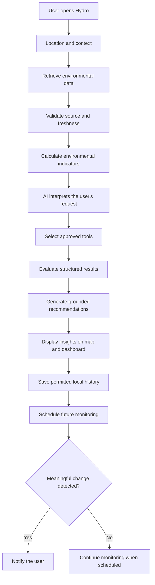
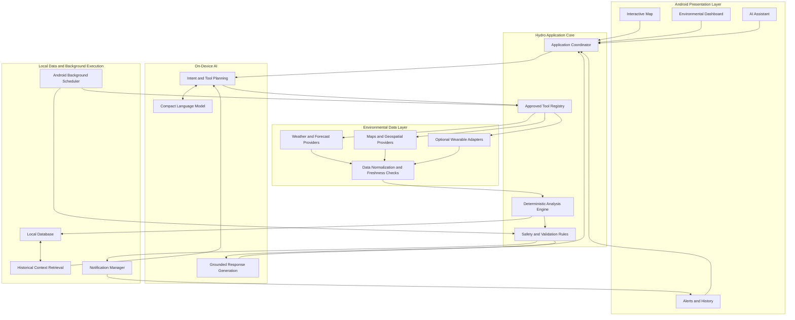
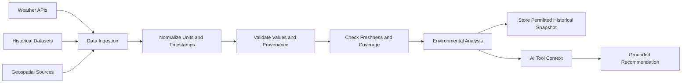
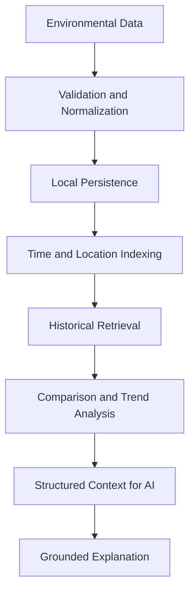
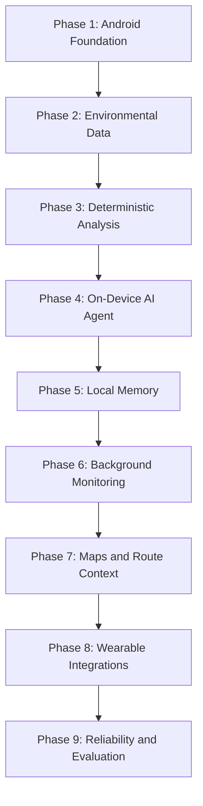

# Hydro 🌍

### Your personal AI-powered environmental intelligence companion.

**What if your phone could help you understand the environment before you step into it?**

We build tools to make our lives easier. We build AI assistants to answer questions, applications to manage our work, and smart devices to automate everyday tasks.

But have we built enough tools to solve the problems we personally experience every day?

Imagine waking up in Lagos, Nigeria. The weather looks normal through your window, but the humidity is high, the sun is getting stronger, and you have a 12 km walk ahead of you.

Should you leave now? Should you carry an umbrella? How much water should you bring? Would leaving an hour later make the journey more comfortable? What if the conditions become worse while you are outside?

A conventional weather application might show you the temperature and forecast.

**But what if an application could help you understand what those conditions actually mean for your day?**

That is why we are building **Hydro**.

Hydro is designed to be your personal environmental scout: an AI-powered Android application that gathers environmental information, learns from local history, evaluates conditions, and helps you make more informed decisions about the world around you.

It doesn't need to experience the weather on your behalf. It uses environmental data to help you prepare for it.

> **Hydro: Understand your environment. Prepare for what comes next.**

---

## Table of Contents

- [The Problem](#-the-problem)
- [Our Vision](#-our-vision)
- [What Is Hydro?](#-what-is-hydro)
- [How Hydro Works](#-how-hydro-works)
- [Core Features](#-core-features)
- [Architecture](#-architecture)
- [The AI Agent](#-the-ai-agent)
- [Environmental Intelligence Pipeline](#-environmental-intelligence-pipeline)
- [Local Memory and Learning](#-local-memory-and-learning)
- [Wearable Integration](#-wearable-integration)
- [Technology Stack](#-technology-stack)
- [Privacy and Safety](#-privacy-and-safety)
- [Getting Started](#-getting-started)
- [Project Roadmap](#-project-roadmap)
- [Limitations](#-limitations)
- [Research and References](#-research-and-references)

---

## 🌍 The Problem

Weather information is widely available, but raw weather information does not automatically translate into useful personal decisions.

Knowing that the temperature is 34°C is one thing. Understanding how temperature, humidity, solar exposure, wind, activity, and time outdoors affect your plans is another.

Many people make outdoor decisions without considering the full environmental picture.

### Consider these scenarios

**1. The daily commute**

You are about to walk several kilometres to school or work. You need to decide what to carry, when to leave, and whether the conditions make your journey more demanding.

**2. The unexpected heat**

You are outside when environmental conditions become increasingly uncomfortable. You would benefit from an early warning rather than discovering the change when it is already affecting you.

**3. The unfamiliar destination**

You plan to travel somewhere you have never visited. You want to understand the expected conditions along the way, not just the weather at your destination.

**4. The forgotten pattern**

Yesterday was unusually hot. Today looks similar, but you have no convenient way to compare the two days, examine the trend, or use that information to plan ahead.

**5. The disconnected data**

Your weather application knows about the forecast. Your wearable may know about your activity. Your map knows about your destination.

But these sources do not necessarily work together to provide one useful, context-aware recommendation.

### The gap

The problem is not a lack of environmental data.

**The problem is turning environmental data into practical, personalized, and timely decisions.**

Hydro aims to bridge that gap.

---

## 💡 Our Vision

Hydro is built around one question:

**Can we build an AI companion that understands the environment around us and helps us respond to it?**

Instead of treating weather as an isolated number, Hydro combines environmental observations, forecasts, geographical context, historical records, and optional wearable information.

It then uses a combination of deterministic calculations and AI-driven tool orchestration to help answer questions such as:

- Is this a good time to go for a walk?
- What should I prepare for a long outdoor journey?
- How do the conditions today compare with yesterday?
- Is the forecast suggesting a period of increasing heat?
- Which part of my planned journey may have greater environmental exposure?
- What has changed since my last assessment?
- Should I reconsider my outdoor plans based on the available information?

Hydro is not intended to replace weather services, medical professionals, or emergency services.

Its purpose is to make environmental information more useful in everyday life.

---

## 🌱 What Is Hydro?

Hydro is an **AI-powered, local-first environmental intelligence application for Android**.

Its proposed architecture combines:

- **Environmental intelligence:** Weather, humidity, solar exposure, wind, and historical conditions.
- **AI-powered reasoning:** An on-device model that interprets requests and coordinates approved tools.
- **Geospatial intelligence:** Location-aware assessments and route-related environmental context.
- **Local memory:** Historical records that allow users to compare conditions over time.
- **Proactive monitoring:** Background checks and notifications when supported by Android's scheduling and execution policies.
- **Wearable integration:** Optional activity and physiological context from supported devices and APIs.
- **Privacy by design:** Local storage and on-device inference as the default architectural direction.

The objective is to provide a unified environmental companion without requiring a custom Hydro backend for its core operation.

External data providers may still be needed for current forecasts, historical weather, maps, and other information.

---

## 🗺️ How Hydro Works

Hydro is designed around a simple interaction.

### 1. Understand the environment

When the application opens, the user sees a map centred on their location.

Hydro retrieves available environmental information for that location, including relevant weather conditions and forecasts.

### 2. Understand the user's intention

The user can explore the map, choose a destination, select a travel mode, or ask Hydro a question.

For example:

> "I need to walk 12 km this afternoon. What should I prepare for?"

### 3. Gather relevant information

The AI agent determines which approved tools are needed.

It may retrieve weather data, examine the forecast, calculate exposure-related indicators, and query relevant local history.

### 4. Analyse the situation

Deterministic application logic evaluates the available data. The model interprets the results and identifies the information relevant to the user's question.

Hydro distinguishes measured observations, modelled forecasts, and its own derived assessments.

### 5. Deliver actionable guidance

Instead of returning only a list of weather variables, Hydro explains the relevant conditions and offers practical suggestions based on the available evidence.

### 6. Remember and monitor

With appropriate permissions, Hydro can save useful records locally and schedule future checks.

When a meaningful change is detected, it can notify the user, subject to Android's background-execution constraints.



---

## 🚀 Core Features

The following describes the intended product capabilities. Individual features should be labelled as implemented, in progress, or planned according to the actual repository state.

### 1. Interactive Environmental Map

A map-first interface for exploring environmental conditions.

- Display the user's current location.
- Explore conditions at another location.
- Select destinations and inspect available forecasts.
- Visualize environmental patterns when suitable geospatial data is available.
- Explore historical conditions for supported locations.
- Show data freshness and availability.

### 2. AI Environmental Assistant

A conversational interface that helps users understand their surroundings.

Example questions:

- "How does today's weather compare with yesterday?"
- "What should I prepare for a long walk?"
- "When is the forecast suggesting lower temperatures?"
- "What changed in my local environmental conditions?"
- "Explain why you are recommending that I reconsider this journey."

The assistant uses tools to retrieve and analyse information rather than inventing environmental readings.

### 3. Heat and Exposure Intelligence

Hydro can combine relevant environmental variables to assess conditions that may increase heat exposure.

Depending on data availability, the analysis may consider:

- Air temperature.
- Relative humidity.
- Apparent temperature.
- Wind speed.
- Solar radiation.
- Time of day.
- Planned activity and duration.

The exact risk calculation must be explicitly defined, validated, and documented. A general heat score should not be presented as a medical diagnosis or an officially validated heat-stress index.

### 4. Route-Aware Planning

Users can select a destination and provide a travel mode or estimated journey duration.

Hydro aims to help them understand:

- Forecast conditions at relevant times.
- Potential periods of increased heat exposure.
- Whether the forecast suggests a more comfortable departure window.
- Practical preparation and rest considerations.
- Environmental differences between available route segments, where supporting data exists.

A route cannot be described as shaded, cooler, or safer unless the underlying data supports that conclusion.

### 5. Personal Environmental Memory

Hydro is designed to retain useful historical information locally.

Users can compare previous assessments, review weather history, and identify patterns in available environmental records.

For example:

> "Yesterday's afternoon conditions were different from today's forecast. Here's what changed."

Hydro must preserve the distinction between what was observed, what was forecast, and what it calculated.

### 6. Proactive Environmental Alerts

Hydro aims to monitor supported environmental data and notify users when predefined conditions warrant attention.

Potential alert categories include:

- Increasing heat exposure.
- Significant forecast changes.
- Approaching periods of high temperatures.
- Changes relevant to a saved journey.
- User-defined environmental thresholds.

Notifications should be based on explicit rules, source freshness, and deduplication rather than the language model's unverified judgement alone.

### 7. Optional Wearable Intelligence

Where supported devices and permissions allow, Hydro can incorporate activity and health-related signals into its contextual analysis.

Potential inputs include step counts, activity duration, heart rate, and other supported measurements.

These signals can provide context, but they cannot independently establish dehydration, core body temperature, or a medical diagnosis.

### 8. Everyday Environmental Comfort

Hydro's longer-term vision extends beyond outdoor weather.

Potential use cases include planning outdoor activities, understanding overnight weather trends, and preparing for expected environmental changes.

Indoor temperature or sleeping conditions should not be inferred directly from outdoor weather when the necessary indoor measurements are unavailable.

---

## 🏗️ Architecture

Hydro is designed as an Android-first application with local persistence and an on-device AI agent.

The architecture separates platform responsibilities, environmental data access, deterministic analysis, AI orchestration, and user-facing presentation.

This separation is important because an AI model should not be responsible for every part of the application.

For example, the model can decide that a question requires a weather lookup. Kotlin application logic should handle the network request, validate the response, enforce permissions, and return structured results.

### High-level system architecture



### Architecture principles

**No mandatory custom backend**

Core application logic, local memory, AI orchestration, and supported background tasks are designed to run on the device.

External providers may still supply data. Provider credentials, quotas, licensing, and terms must be evaluated individually. Secret API keys cannot be safely protected simply by embedding them in an APK.

**On-device intelligence**

The AI model is intended to run locally, subject to Android hardware compatibility, model size, latency, and memory constraints.

**Deterministic calculations**

Numerical calculations, validation, permission checks, and notification rules belong to explicit application logic.

**Typed interfaces**

Components should exchange structured data rather than depending on unrestricted natural-language output.

**Graceful degradation**

When a provider is unavailable, Hydro should identify the missing information, avoid pretending it has current readings, and use only valid cached data where appropriate.

---

## 🧠 The AI Agent

Hydro's AI is not intended to be just a chatbot placed on top of a weather API.

It is designed as a constrained agent that can interpret a request, select approved tools, examine their results, retrieve relevant context, and produce a grounded explanation.

### Example interaction

**User:**

"I need to walk 12 km this afternoon. What should I prepare for?"

**Hydro's intended reasoning flow:**

1. Interpret the request as outdoor journey planning.
2. Determine which information is missing, such as the starting location or approximate departure time.
3. Request the necessary permissions or clarification.
4. Retrieve available weather forecasts for the relevant time and locations.
5. Calculate relevant environmental indicators using validated application logic.
6. Check relevant historical records if useful.
7. Evaluate the evidence and its freshness.
8. Produce practical, appropriately qualified recommendations.
9. Save the assessment if permitted by the user's settings.

The agent should not claim to know the exact temperature along every metre of a route when the available weather data has much coarser spatial resolution.

### Tool-driven intelligence

Hydro's proposed tool registry may include:

| Tool | Responsibility |
|---|---|
| `get_current_location` | Obtain location when permission is granted |
| `get_weather` | Retrieve current or forecast conditions |
| `get_historical_weather` | Retrieve historical environmental data |
| `calculate_heat_risk` | Calculate a documented environmental indicator |
| `get_route_conditions` | Retrieve supported route-related context |
| `query_memory` | Retrieve relevant local history |
| `get_wearable_data` | Read permitted measurements from supported sources |
| `analyze_anomaly` | Detect changes using explicit rules |
| `create_notification` | Submit a notification request to application policy |
| `get_heat_map` | Retrieve or derive a supported spatial visualization |

These names describe proposed interfaces; they are not a claim that every tool has already been implemented.

### Why use a compact model?

Running the agent locally supports the privacy-first design and reduces dependence on a remote language-model service.

However, a small model can make mistakes when selecting tools, following instructions, or interpreting structured responses.

Hydro should therefore evaluate candidate models for:

- Tool-selection accuracy.
- Structured output validity.
- Instruction following.
- Multi-step task reliability.
- Android memory usage.
- Inference latency.
- Battery and thermal impact.
- Model licensing and distribution requirements.

A model should never be trusted to bypass application permissions or invent missing data.

---

## 🌦️ Environmental Intelligence Pipeline

Environmental data is useful only when its meaning, origin, and freshness are understood.

Hydro is designed to normalize provider responses into a common internal representation before using them in calculations or AI reasoning.



### Candidate data sources

These providers are candidates for integration. Their suitability, terms, access restrictions, geographic coverage, and commercial-use requirements must be confirmed before production use.

| Source | Potential use | Reference |
|---|---|---|
| Open-Meteo | Weather forecasts and historical weather data | [Documentation](https://open-meteo.com/en/docs) |
| Open-Meteo Historical Weather API | Historical weather analysis | [Documentation](https://open-meteo.com/en/docs/historical-weather-api) |
| NASA Earthdata | Earth-observation and satellite datasets | [Documentation](https://www.earthdata.nasa.gov/) |
| NASA POWER | Solar and meteorological data | [Documentation](https://power.larc.nasa.gov/) |
| Nigeria Meteorological Agency (NiMet) | Nigerian meteorological information and services | [Official website](https://nimet.gov.ng/) |

Open-Meteo documents historical weather datasets covering multiple decades, while its historical forecast archive supports analysis of past forecast runs. These are different data products and should not be treated as interchangeable. [Historical Weather API](https://open-meteo.com/en/docs/historical-weather-api) · [Historical Forecast API](https://open-meteo.com/en/docs/historical-forecast-api)

### Data quality requirements

Each environmental record should preserve relevant metadata, including:

- Source and retrieval time.
- Observation or forecast timestamp.
- Geographic coordinates or coverage.
- Units and variable definitions.
- Whether the value is observed, forecast, or derived.
- Available quality indicators.
- Data freshness and known limitations.

Satellite land-surface temperature must not be presented as if it were the same measurement as near-surface air temperature.

Likewise, a weather forecast is not a direct observation of the user's exact surroundings.

---

## 🧠 Local Memory and Learning

Hydro's local memory is intended to make environmental intelligence more useful over time.

Rather than treating every question as an isolated conversation, Hydro can preserve permitted records that support comparisons and historical analysis.

### Potential memory records

- Environmental observations.
- Forecast snapshots.
- Previous assessments.
- User-defined preferences.
- Alert history.
- Saved locations and journeys.
- Supported wearable summaries, with permission.

### Example

A user asks:

> "Was yesterday hotter than today?"

Hydro retrieves the relevant records, checks that the timestamps and measurements are comparable, and explains the difference.

If only a forecast is available for today, Hydro must identify it as a forecast rather than claiming it is an observed measurement.

### Memory architecture



This architecture does not require a cloud vector database for its initial implementation. Local database queries and indexed historical records can support the first version. More sophisticated retrieval can be introduced if evaluation demonstrates a real need.

---

## ⌚ Wearable Integration

Hydro's longer-term vision includes optional integration with supported wearable devices and Android health APIs.

Depending on the device, provider, permissions, and API availability, this may include:

- Steps and activity duration.
- Exercise sessions.
- Heart-rate measurements.
- Other supported physiological measurements.

The application should use capability-based adapters rather than assuming every wearable exposes the same data.

Wearable measurements are contextual signals, not definitive medical conclusions. For example, heart rate alone cannot establish dehydration or diagnose heat-related illness.

Users should be able to review and revoke access to their data.

---

## 🛠️ Technology Stack

Hydro's proposed implementation uses Android-native platform capabilities and an on-device AI runtime.

The final stack should be confirmed against the repository and the models selected for the target devices.

| Component | Proposed technology | Purpose |
|---|---|---|
| Android application | Kotlin | Application lifecycle, UI integration, permissions, and platform services |
| UI | Jetpack Compose | Native Android user interface |
| AI inference | Google AI Edge LiteRT-LM or another compatible runtime | On-device language-model execution |
| AI model | Evaluated compact open-weight model | Intent interpretation and tool orchestration |
| Local persistence | Room / SQLite | Structured local history and preferences |
| Background execution | Android WorkManager | Deferrable environmental refresh and monitoring |
| Mapping | A suitable Android-compatible map SDK | Location, destination selection, and supported map layers |
| Environmental data | Verified external provider APIs | Weather, forecast, and historical information |
| Wearable integration | Health Connect and supported device APIs | Permission-based access to available measurements |
| Testing | Unit, integration, and Android instrumentation tests | Correctness, reliability, and platform verification |

### Why on-device AI?

Google AI Edge provides tooling for deploying machine-learning models on devices, including Android, and LiteRT-LM provides capabilities for running language models locally. The selected runtime and model must still be validated against Hydro's specific requirements. [Google AI Edge](https://developers.google.com/edge) · [LiteRT](https://developers.google.com/edge/litert) · [LiteRT-LM](https://developers.google.com/edge/litert-lm/overview)

Hydro should benchmark candidate models on real Android hardware before committing to a specific model or inference runtime.

---

## 🔒 Privacy and Safety

Environmental intelligence can involve sensitive information, particularly when location and wearable data are involved.

Hydro's architecture prioritizes local processing and explicit user control.

### Privacy principles

- Keep application history on-device by default.
- Request location and health-related permissions only when needed.
- Use the minimum data necessary for each feature.
- Explain why each permission is required.
- Allow users to control retained history.
- Avoid sending private local history to external services unnecessarily.
- Never embed secret provider credentials in the application package.
- Identify external services and their data requirements.

### Safety principles

- Validate external responses before using them.
- Track data freshness and source provenance.
- Do not fabricate missing measurements.
- Distinguish forecasts from observations.
- Use deterministic logic for safety-sensitive thresholds.
- Make uncertainty visible.
- Avoid unsupported medical claims.
- Use timeouts, bounded tool execution, and clear failure states.
- Deduplicate alerts to avoid notification spam.

### Background monitoring

Hydro intends to provide proactive alerts without requiring users to keep the application open.

However, Android controls background execution. WorkManager periodic tasks have a minimum repeat interval of 15 minutes, and the operating system may defer execution further. WorkManager therefore cannot guarantee exact real-time monitoring intervals.

The implementation must choose an appropriate background strategy for the required latency, battery consumption, and Android platform restrictions. [Android background work documentation](https://developer.android.com/develop/background-work/background-tasks/persistent/getting-started/define-work)

---

## 🚀 Getting Started

Hydro is an Android-first project. The following is a proposed development setup; exact commands depend on the repository's current structure.

### Prerequisites

- Android Studio.
- Android SDK compatible with the project's Gradle configuration.
- A compatible Android device or emulator.
- Git.
- Access to any external providers required by the implemented features.

### Clone the repository

```bash
git clone <YOUR_REPOSITORY_URL>
cd Hydro
```

### Open the project

Open the repository in Android Studio and allow Gradle to synchronize.

Review the project's documented SDK requirements and dependency configuration before building.

### Configure data providers

If the implemented application requires provider configuration, follow the instructions in the relevant environment or configuration files.

Do not commit secret API keys, private credentials, or personal data to the repository.

### Build and run

Use Android Studio to build and run the application on a compatible device or emulator.

The actual build commands, required configuration, model installation steps, and supported Android versions should be documented here once verified against the repository.

> **Development status:** This README describes Hydro's product vision and intended architecture. Features, dependencies, setup commands, and integrations should be marked as implemented only after they have been verified in the codebase.

---

## 🗺️ Project Roadmap

Hydro is intended to evolve from reliable environmental data access into a more personalized, proactive intelligence system.



### Phase 1 — Android Foundation

- Establish the application structure.
- Implement permissions and lifecycle management.
- Define shared interfaces and local storage.
- Build the initial map-first experience.

### Phase 2 — Environmental Data

- Integrate a verified weather provider.
- Normalize measurements and timestamps.
- Implement source freshness checks.
- Handle unavailable data and network failures.

### Phase 3 — Deterministic Analysis

- Define documented environmental indicators.
- Implement calculations and threshold rules.
- Test units, edge cases, and invalid inputs.
- Ensure recommendations are grounded in actual inputs.

### Phase 4 — On-Device AI

- Evaluate candidate models and inference runtimes.
- Implement a constrained tool registry.
- Validate model outputs and tool arguments.
- Benchmark memory, latency, battery, and thermal behaviour.

### Phase 5 — Local Memory

- Persist permitted observations, forecasts, and assessments.
- Support comparisons across time.
- Retrieve relevant historical context.
- Provide retention and deletion controls.

### Phase 6 — Background Monitoring

- Schedule supported background work.
- Detect meaningful changes using explicit rules.
- Implement notification permissions and deduplication.
- Evaluate battery consumption and scheduling behaviour.

### Phase 7 — Maps and Route Context

- Add destination selection and route integration.
- Display supported environmental layers.
- Clearly communicate spatial and temporal uncertainty.

### Phase 8 — Wearable Integrations

- Add capability-based adapters.
- Request permissions only when needed.
- Handle missing or inconsistent measurements.
- Evaluate the usefulness of wearable context.

### Phase 9 — Reliability and Evaluation

- Test provider failure and offline scenarios.
- Evaluate model tool-call accuracy.
- Measure environmental calculation correctness.
- Benchmark performance on representative Android devices.
- Test battery use, memory pressure, and notification usefulness.

---

## 📊 How We Measure Success

Hydro should be evaluated on whether it produces reliable, useful environmental intelligence, not merely whether its AI can generate convincing answers.

| Area | Evaluation |
|---|---|
| Data quality | Source freshness, valid units, timestamp correctness, and provenance |
| Analysis | Correctness of documented calculations and thresholds |
| AI reliability | Tool-selection accuracy, valid arguments, and grounded responses |
| Historical analysis | Correct comparisons between compatible records |
| Performance | Startup time, inference latency, memory usage, and app size |
| Efficiency | Battery consumption and thermal behaviour |
| Proactive alerts | Useful alerts, duplicate rate, and missed threshold events |
| Privacy | Permission correctness and local-data handling |
| Resilience | Behaviour during network failures and unavailable provider responses |

The evaluation process should include test cases where the correct response is to ask for more information, report uncertainty, or decline to make a conclusion because the required data is unavailable.

---

## ⚠️ Limitations

Hydro's recommendations depend on the quality, coverage, and freshness of its input data.

- Forecasts can be inaccurate and may not reflect conditions at a precise point along a route.
- Weather APIs may have different spatial resolutions, update schedules, and licensing requirements.
- Historical weather models do not necessarily represent direct measurements at the user's exact location.
- Background execution may be delayed by Android.
- On-device models vary in quality and performance across hardware.
- Wearable data availability depends on the device, permissions, and supported APIs.
- Environmental indicators do not replace professional medical advice or emergency services.
- Offline operation is limited to locally available data and capabilities.

Hydro should communicate these limitations to users rather than conceal them behind an AI-generated answer.

---

## 🌱 Why Hydro?

We have built tools to help us communicate, work, travel, learn, and automate tasks.

Hydro explores another possibility: **what if technology could help us understand the environment we live in and prepare for its changing conditions?**

The goal is not to replace existing weather services. It is to connect environmental data, local history, AI-driven tool orchestration, and Android-native capabilities into a practical personal companion.

A tool that does not merely tell you what the weather is.

A tool that helps you understand what it means for you.

**Hydro is your environmental scout.**

---

## 📚 Research and References

The following primary documentation informs the proposed architecture.

### Android and on-device AI

- [Google AI Edge](https://developers.google.com/edge)
- [LiteRT documentation](https://developers.google.com/edge/litert)
- [LiteRT-LM overview](https://developers.google.com/edge/litert-lm/overview)
- [Android background work](https://developer.android.com/develop/background-work/background-tasks/persistent/getting-started/define-work)
- [Health Connect documentation](https://developer.android.com/health-and-fitness/guides/health-connect)

### Environmental data

- [Open-Meteo Weather API](https://open-meteo.com/en/docs)
- [Open-Meteo Historical Weather API](https://open-meteo.com/en/docs/historical-weather-api)
- [Open-Meteo Historical Forecast API](https://open-meteo.com/en/docs/historical-forecast-api)
- [NASA Earthdata](https://www.earthdata.nasa.gov/)
- [NASA POWER](https://power.larc.nasa.gov/)
- [Nigeria Meteorological Agency](https://nimet.gov.ng/)

### Documentation practices

- [Google Documentation Best Practices](https://google.github.io/styleguide/docguide/best_practices.html)
- [Google README Guidelines](https://google.github.io/styleguide/docguide/READMEs.html)

---

## 🤝 Contributing

Contributions are welcome as Hydro develops.

Potential areas include:

- Android application development.
- Environmental data integrations.
- On-device model evaluation.
- Deterministic environmental analysis.
- Local persistence and historical retrieval.
- Mapping and geospatial visualizations.
- Wearable integrations.
- Testing, privacy, and performance evaluation.

Please open an issue to discuss substantial changes before submitting a pull request.

## 📄 License

A license has not yet been specified. Add a `LICENSE` file before distributing the project under an open-source license.

---

<p align="center">
  <strong>Hydro — Understand your environment. Prepare for what comes next.</strong>
</p>
