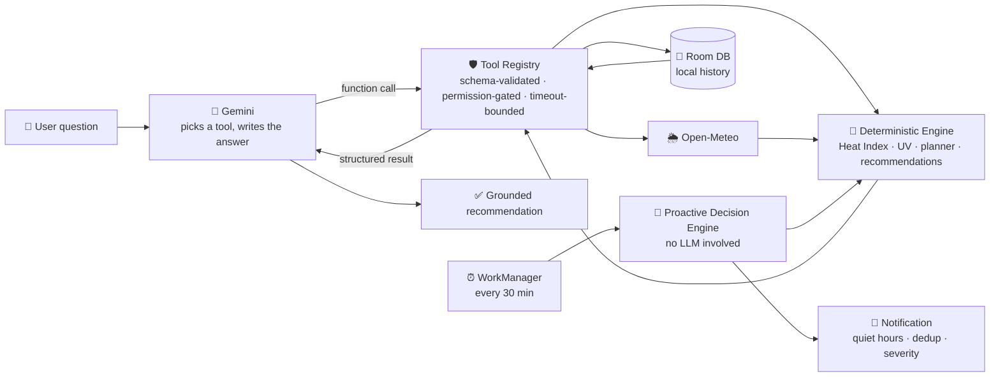
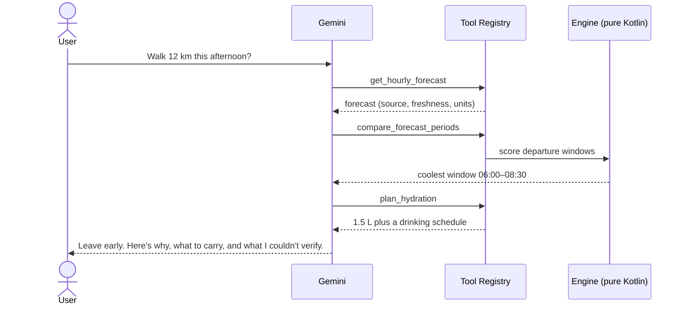

<div align="center">

# 💧 Hydro

### Weather apps tell you it's 34°C. Hydro tells you whether to leave now or at 5 pm.

An Android AI companion that turns raw weather data into **personal, evidence-backed decisions** about heat, sun and hydration, using deterministic science for the numbers and AI only for the explanation.

`Kotlin` · `Jetpack Compose` · `Room` · `WorkManager` · `Gemini API` · `Open-Meteo`

**[🎥 Demo video: TODO]** · **[📱 Download APK: TODO]** · **[📊 Pitch deck: TODO]**

</div>

---

## 🔥 The Problem

> "It's 34°C." Okay, but can I walk 12 km this afternoon?

Weather apps hand you numbers and leave the interpretation to you. People then have to work out for themselves:

- Is the *feels-like* temperature dangerous once humidity and sun are included?
- When is the coolest window to leave?
- How much water should I carry?
- Is today actually worse than yesterday?

Getting that wrong means heat exhaustion, ruined plans, and (in hot regions) real health risk. This matters most for people who work, walk or commute outdoors in hot climates, including much of Nigeria and West Africa.

## 💡 The Solution

Hydro is your **personal environmental scout**. Ask it a plain-language question and it:

1. Fetches live forecast and history for your location.
2. Computes heat and UV risk with **published formulas** (NOAA/NWS Heat Index, WHO UV Index).
3. Finds the best time window for your activity.
4. Explains what to do, in plain language, and says so when the data isn't good enough.

> **The AI never invents a risk score.** The model chooses which tool to call and phrases the answer. Every number comes from tested application code.

| Ordinary weather app | Hydro |
|---|---|
| "34°C, 70% humidity" | "Feels like 41°C. Leave before 9:00 or after 17:00, and carry 1.5 L of water." |
| Same alert for everyone | Quiet hours, severity threshold and dedup you control |
| Forgets yesterday | Compares today with yesterday at the same clock time |
| Silently shows stale data | Marks cached/stale data and refuses to give a false all-clear |

## ✨ What Works Today

This is a hackathon **MVP**. The intelligence engine is built and tested. The chat UI is the next step.

| Feature | Status |
|---|---|
| Live weather, hourly forecast and historical data (Open-Meteo) | ✅ Working |
| NOAA/NWS Heat Index and WHO UV Index | ✅ Working, unit-tested |
| Activity window planner ("best time to leave") | ✅ Working, unit-tested |
| Recommendations: urgency, ordered actions, evidence, limitations | ✅ Working |
| Local memory and "today vs. yesterday" comparison | ✅ Working (Room/SQLite) |
| Forecast verification (how accurate the forecast turned out to be) | ✅ Working |
| Proactive background alerts (WorkManager, every 30 min) with notifications | ✅ Working |
| AI tool registry (24 validated tools) and Gemini orchestrator | ✅ Backend wired |
| Live news on heat, air quality, floods and storms for your area (Tavily) | ✅ Tool ready, needs `TAVILY_API_KEY` |
| Air quality: US AQI, PM2.5, PM10, ozone, NO₂, SO₂, CO, dust (Open-Meteo) | ✅ Tool ready, no key needed |
| Recent solar irradiance, temperature range and rainfall (NASA POWER) | ✅ Tool ready, no key needed |
| Android dashboard: current conditions, heat index, UV, freshness | ✅ One vertical slice |
| Chat UI for the AI assistant | 🚧 Next up |
| Real routes (walk/bike/drive/transit), geocoding, nearby shade/cooling/medical (Google Maps Platform) | ✅ Tools ready, need `GOOGLE_MAPS_API_KEY` |
| "What's reachable in 10 minutes on foot?" (Isochrones), area green/medical density, route elevation, time zone for any place | ✅ Tools ready, need `GOOGLE_MAPS_API_KEY` |
| Pollen forecast and Google weather second opinion | ✅ Tools ready, need `GOOGLE_MAPS_API_KEY` |
| Heat-map data layer (grid of heat index/UV/temperature) | ✅ Data ready, map rendering is next |
| Wearables via Health Connect (read-only) | ✅ Data source ready, permission screen is next |
| Interactive map screen, alerts/history/settings screens | 🚧 Next up |

## 🧠 How It Works



**Example:** *"I need to walk 12 km this afternoon. What should I prepare for?"*



### Design principles

- **AI explains, code calculates.** Thresholds, formulas, safety logic and permissions live in tested Kotlin and never in the model.
- **Honest by construction.** Missing data stays *unavailable* and is never zero-filled. Observations, forecasts and derived values are kept distinct. Stale data is never presented as a calm all-clear.
- **Closed tool set.** The model can only call 13 registered tools with validated arguments.
- **Privacy-first.** History stays on the device. Gemini runs stateless, so no location-bearing prompt is retained. Logs redact GPS coordinates and credentials.
- **Model-agnostic.** `LlmClient` is an interface. A benchmark harness scores tool-selection accuracy so that choosing a Gemini tier is a measurement.
- **News is treated as untrusted.** Article text is length-capped, labelled as third-party data, and the model is told never to follow instructions inside it. Only a place name, never coordinates, is sent to the news provider.

### The 24 AI tools

`get_weather` · `get_hourly_forecast` · `get_historical_weather` · `calculate_heat_risk` · `compare_forecast_periods` · `query_memory` · `get_current_location` · `analyze_anomaly` · `get_route_conditions` · `get_heat_map` · `get_wearable_data` · `create_notification` · `plan_hydration` · `get_environmental_news` · `get_air_quality` · `get_solar_climate` · `geocode_place` · `get_pollen` · `find_nearby_relief` · `get_google_weather` · `find_relief_within_reach` · `get_area_insights` · `get_elevation_profile` · `get_time_zone`

All 24 are implemented in `:core-engine`. Tools whose Android integration isn't wired yet (route, heat map, wearable) return an explicit failure.

## 🛠️ Tech Stack

| Layer | Tech | Why |
|---|---|---|
| App | Kotlin, Jetpack Compose | Native, with Android permissions and background work |
| Engine | Pure Kotlin/JVM module (`:core-engine`) | Platform-free, so it is fast to unit test and reusable |
| AI | Gemini API (native function calling) | Reliable tool use with no model download for the MVP |
| Weather | Open-Meteo | Free, no API key, forecast plus historical reanalysis |
| Air quality | Open-Meteo Air Quality | Free, no key, US/EU AQI and the major pollutants |
| Satellite climate | NASA POWER | Free, no key, solar irradiance and recent climate |
| News | Tavily | Fresh local news on heat, floods and air-quality alerts |
| Maps data | Google Maps Platform | Routes, geocoding, places, weather, air quality, pollen |
| Wearables | Android Health Connect | Read-only, per-metric consent |
| Storage | Room / SQLite | Local-first history with no custom backend |
| Background | WorkManager | Battery-friendly proactive alerts |
| Science | NOAA/NWS Heat Index, WHO UV Index | Documented, citable formulas |
| Tests | JUnit with deterministic fixtures and a fake HTTP transport | Offline and reproducible, with no API key needed |

## 🚀 Run It

**Requirements:** JDK 17+ (Android Studio's bundled JDK works), Android SDK, a device or emulator on Android 8.0+ (`minSdk 26`).

```bash
git clone https://github.com/Ferousco-dev/Hydro.git
cd Hydro

# (optional) enable the AI assistant: get a key at https://aistudio.google.com/apikey
echo "GEMINI_API_KEY=your-key" >> local.properties
# (optional) enable the news tool: get a key at https://app.tavily.com
echo "TAVILY_API_KEY=your-key" >> local.properties
# (optional) Google Maps Platform: routes, places, air quality, pollen, weather
echo "GOOGLE_MAPS_API_KEY=your-key" >> local.properties

./gradlew :app:assembleDebug     # build the APK
./gradlew :core-engine:test :app:testDebugUnitTest   # run the tests
```

The app runs **without** a Gemini key. Weather, heat index, planning, history and alerts all work, and only the conversational layer reports `ModelUnavailable`.

> ⚠️ A key embedded in an APK can be extracted. That is acceptable for a hackathon prototype. A production build must proxy Gemini through a server.

## 🧪 Quality

- JVM unit tests cover the heat formulas, window planning, recommendations, memory, tool registry, orchestrator, Gemini client and benchmark harness. The Gemini client is tested against a fake transport, so no network or key is needed.
- `ToolCallBenchmarkHarness` runs a versioned prompt suite against any `LlmClient` and reports tool-selection accuracy, malformed-call rate and latency.
- Known gaps: Room tests use a fake DAO and there are no instrumentation or UI tests yet.
- CI: `.github/workflows/ci.yml` runs the core and app tests and builds the debug APK.

## ⚠️ Honest Limitations

- Hydro gives **informational guidance, not medical advice**. Wearable data can never establish dehydration or a diagnosis.
- WorkManager is best-effort. Android can delay background jobs, so alerts are not guaranteed real-time.
- Open-Meteo's free tier is non-commercial (CC-BY 4.0), so a commercial release needs a licensing review.
- Route-level claims (shade, cooler paths) are not made without supporting data.

## 🗺️ Roadmap

1. **Chat UI** wired to the existing orchestrator.
2. **Map view** with destination forecast and heat layer.
3. **Health Connect** integration for activity context.
4. **Local-region data** (NiMet, NASA POWER) for better West Africa coverage.
5. **Server-side key proxy** for production, so no API key ships in the APK.

## 📁 Repository Layout

```
core-engine/   Pure-Kotlin brain: models, Open-Meteo adapter, heat/UV, planner,
               recommendations, memory, tool registry, orchestrator, Gemini client
app/           Android app: Compose UI, Room, location, WorkManager, notifications
docs/          CORE_ENGINE.md: formulas, schemas, missing-data semantics
scripts/       verify-core-engine.sh
```

## 📚 Documentation

| Doc | What's inside |
|---|---|
| [PRD](docs/PRD.md) | Problem, users, requirements, metrics, risks |
| [Architecture](docs/ARCHITECTURE.md) | Modules, tool registry, data flow |
| [Data sources](docs/DATA_SOURCES.md) | Every API, key, licence and caveat |
| [ADRs](docs/adr/README.md) | Why we made each major decision |
| [Setup](docs/SETUP.md) | Keys, build, troubleshooting |
| [Security & privacy](docs/SECURITY.md) | Threat model and known limits |
| [Five-day plan](docs/ROADMAP.md) | Daily goals, demo script, submission checklist |
| [Core engine](docs/CORE_ENGINE.md) | Formulas, schemas, missing-data semantics |
| [Changelog](CHANGELOG.md) | What changed and when |

## 👥 Team

| Name | Role |
|---|---|
| Feranmi Oresajo ([@Ferousco-dev](https://github.com/Ferousco-dev)) | Mobile Developer |
| Emerald | AI Integration Expert |

Built for **TODO: hackathon name** · TODO: dates

## 🤝 Contributing & License

Issues and PRs are welcome. Please open an issue first for larger changes.
License: **TODO** (add a `LICENSE` file before public distribution).

<div align="center">

**Hydro: understand your environment, and prepare for what comes next.**

</div>
