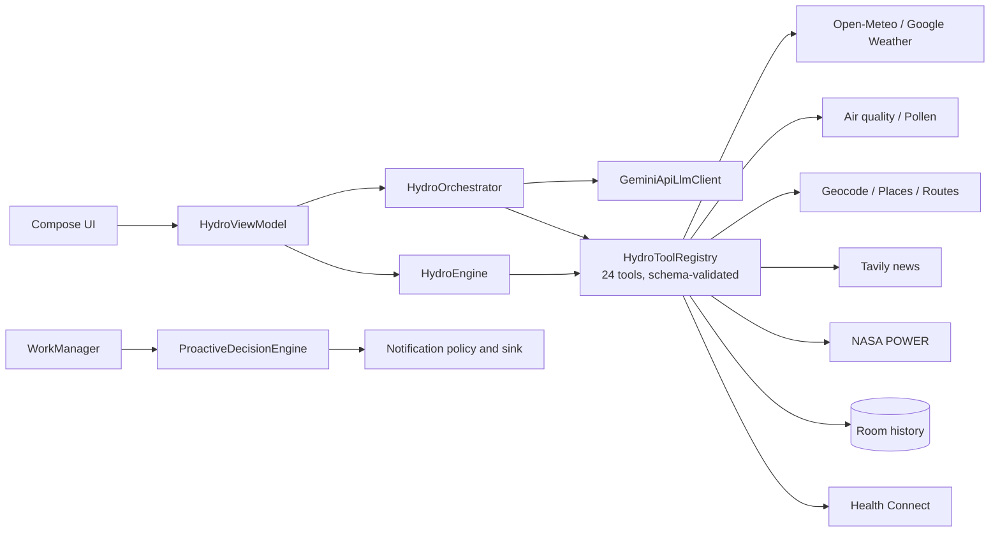

# Architecture

## Principle
**The model explains, code calculates.** The LLM selects approved tools and phrases the final answer. Heat index, UV categories, window ranking, hydration plans, recommendation urgency and alert thresholds are deterministic Kotlin.

## Modules
```
:core-engine   Pure Kotlin/JVM. Domain models, providers, tools, orchestrator, policies. No Android.
:app           Android shell. Compose UI, Room, WorkManager, notifications, location, Health Connect.
```

## Runtime flow


## Tool registry guarantees
- Only registered tools can run; unknown names are rejected.
- Arguments are validated against a closed schema (`additionalProperties = false`); oversized or malformed JSON is rejected.
- Each tool declares required capabilities, enforced by a `ToolPermissionGate`.
- Every call has a timeout; failures use a documented error-code set.
- No arbitrary URL, file or code execution is reachable from the model.

## Tools (24)
`get_weather`, `get_hourly_forecast`, `get_historical_weather`, `calculate_heat_risk`, `compare_forecast_periods`, `query_memory`, `get_current_location`, `analyze_anomaly`, `get_route_conditions`, `get_heat_map`, `get_wearable_data`, `create_notification`, `plan_hydration`, `get_environmental_news`, `get_air_quality`, `get_solar_climate`, `geocode_place`, `get_pollen`, `find_nearby_relief`, `get_google_weather`, `find_relief_within_reach`, `get_area_insights`, `get_elevation_profile`, `get_time_zone`.

## Provider selection
`HydroApplication` is the composition root. With `GOOGLE_MAPS_API_KEY`, Google providers are used for routing, geocoding and air quality; otherwise great-circle estimate, Open-Meteo geocoder and Open-Meteo air quality. Providers with no free alternative (pollen, places, Google weather) report unavailable.

## Data integrity rules
- Missing values are `Unavailable`, never `0`.
- Observed, forecast, modelled and derived values are separate types.
- Cached responses are marked and never called live.
- Satellite land-surface temperature is not air temperature.

## Background alerts
One unique 30-minute WorkManager job resolves a recent fix or saved home, fetches observation + 12 h forecast, evaluates the next 6 h, applies preference/quiet-hours/dedup policy once, then notifies. Best-effort: Android may delay it.

Deep dive on formulas and schemas: [CORE_ENGINE.md](CORE_ENGINE.md).
